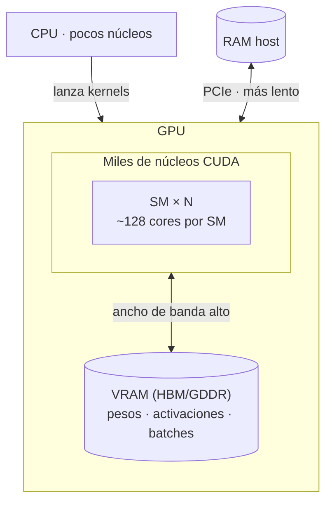

# GPU — scratch (presentación `ai-energy-presentation`)

Notas de autoría: qué ya está en el video y qué falta. **No** confundir con el taller (`carbon-aware-computing-*`).

---

## Idea para el público

- **CPU:** pocos núcleos rápidos → buena para lógica secuencial (un píxel, un token, una regla tras otra).
- **GPU:** **miles de núcleos** más simples + **VRAM** ancha → mismo cálculo repetido en montones de datos a la vez (píxeles, matrices, attention).
- **Energía:** paralelismo útil, pero una GPU entera consumiendo al 100 % durante entrenamiento es otra historia (slides de coste / DC más adelante).

---

## Diagrama (silicio + memoria)

**Visual en Motion Canvas (pendiente / opcional):** rejilla de SM + barra VRAM encima del die — estilo pixel-art como `VgpuContextSwitchSlide`, pero sin VMs (slide “anatomía” pura).

---

## Qué hay hoy en el repo

| Pieza | Archivo | Beats / slides |
| --- | --- | --- |
| Metáfora píxeles CPU vs GPU | `src/components/CpuGpuSlide.tsx` | `ia-gpu-*` en `paso0-servidores.tsx`: pantalla, zoom shader, scan CPU, tiles GPU en paralelo |
| Entrenamiento (tokens, pesos) | `src/components/TrainingDemo.tsx` | Teacher forcing; no muestra silicio GPU aún |
| vGPU / context switch | `src/components/VgpuContextSwitchSlide.tsx` | VRAM tenant, SM, evacuar a RAM host |
| MIG / partición | `src/components/GpuVirtualizationSlides.tsx` | Aislamiento VRAM, ociosidad |
| Demos inferencia | `InferenceDemo.tsx` | Contraste train vs infer (energía en otros slides) |

**Dependencias:** solo Motion Canvas (`package.json`). No TensorFlow en esta repo — los demos son pedagógicos, no ejecutan kernels reales.

---

## Huecos narrativos (ideas)

- [ ] Slide **anatomía GPU** entre `ia-gpu-paralelo` y bloque entrenamiento: rejilla SM + etiqueta “miles de núcleos” + bloque VRAM.
- [ ] Una línea puente: “los mismos matmul del slide de tokens, aquí van **en paralelo** en VRAM”.
- [ ] No mezclar con setup CUDA del taller (tfjs / pip); es otro repo.

---

## Referencias visuales existentes

- Imagen monitor: `src/assets/gpu-screen.jpg`
- Callout shader: `src/assets/shader-callout-ref.png`
- Colores / layout: `src/theme.ts`, `MOTION-CANVAS-LAYOUT.md`
